<p align="center">
  
</p>

<h1 align="center">TeamCraft</h1>

<p align="center">
  <strong>Open-source product lifecycle management, built in pure Rust.</strong><br />
  Check your CAD data out and in, keep every version, release with reviews,
  follow changes through assemblies and see STEP, mesh and point-cloud models
  in 3D – in the browser, in the desktop app or through the REST API.<br />
  <em>Work in progress: an open-source alternative to Siemens Teamcenter.</em>
</p>

<div align="center">

[![Download][badge-download]][download]
[![Linux][badge-linux]][linux]
[![macOS][badge-macos]][macos]
[![Windows][badge-windows]][windows]
[![Documentation][badge-docs]][docs]

</div>

<p align="center">
  <a href="https://github.com/rudalabs/TeamCraft/actions/workflows/ci.yml"></a>
  <a href="https://github.com/rudalabs/TeamCraft/actions/workflows/desktop.yml"></a>
  <a href="https://github.com/rudalabs/TeamCraft/actions/workflows/docs.yml"></a>
  <a href="https://www.repostatus.org/#wip"></a>
  <a href="https://github.com/rudalabs/TeamCraft/releases"></a>
  <a href="LICENSE"></a>
  
  
</p>

<p align="center">
  <a href="https://rudalabs.github.io/TeamCraft/">Documentation</a> ·
  <a href="#download">Download</a> ·
  <a href="#quick-start">Quick start</a> ·
  <a href="https://rudalabs.github.io/TeamCraft/guide/tour.html">Feature tour</a> ·
  <a href="https://rudalabs.github.io/TeamCraft/reference/formats.html">File formats</a> ·
  <a href="https://rudalabs.github.io/TeamCraft/reference/api.html">REST API</a> ·
  <a href="https://rudalabs.github.io/TeamCraft/api/teamcraft/index.html">Rust API</a> ·
  <a href="CONTRIBUTING.md">Contributing</a>
</p>

<p align="center">
  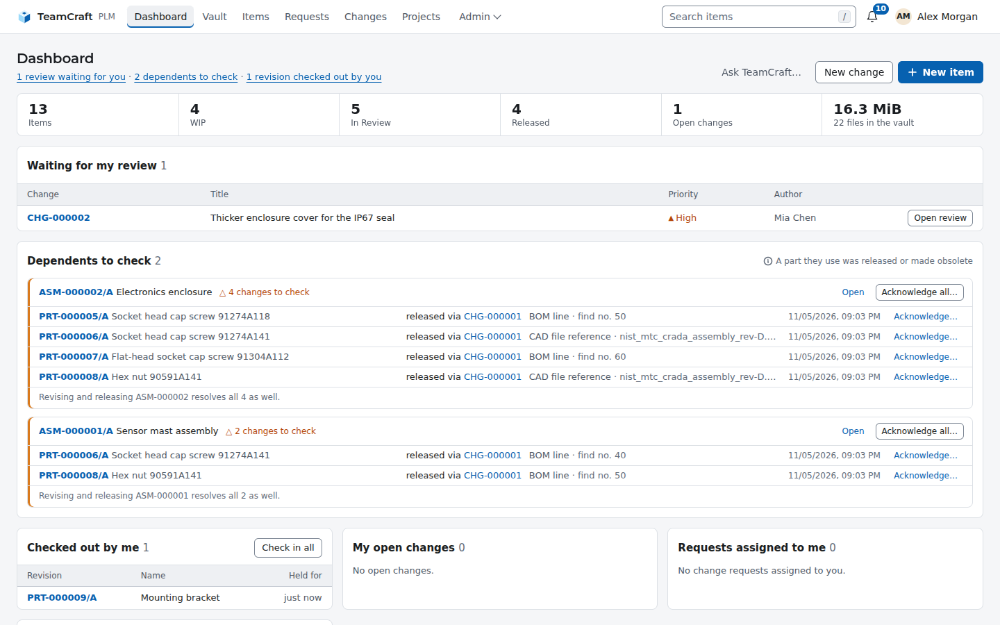
</p>

> [!WARNING]
> **Work in progress: there is no official release yet.** TeamCraft is under
> active development (version 0.x). Features, the REST API, the configuration
> and the database schema can still change at any time. You are welcome to
> try it out and test it, and please
> [report what you find](https://github.com/rudalabs/TeamCraft/issues).
> Don't use it for production data yet, and keep backups of the database and
> the vault.
>
> TeamCraft is provided **"as is", without warranty of any kind**. There is no
> guarantee that it works as described or is fit for any particular purpose,
> and no liability for any damage or data loss. See sections 6 and 7 of the
> [MPL-2.0](LICENSE).

## What works

All of the following works end to end today: creating a project group,
adding items, checking files out and in, building the BOM, releasing through
a reviewed change order and seeing what has to be checked after a release.
It is covered by 114 unit tests and 33 end-to-end tests against a real
PostgreSQL. Until the first release, the database schema is migrated
automatically between commits, but nothing else about compatibility is
promised.

- **Check-out / check-in.** Exclusive locks per revision; check-in stores the
  new file versions and releases the lock in one transaction. Cancel
  check-out and *Cancel upload* take effect immediately. Check-ins are
  checked against the version each file was based on, so a version
  somebody else checked in meanwhile is refused (409) instead of being
  overwritten; per-file status (up to date, modified, outdated, conflict),
  lock age and *Check in all my check-outs* on the dashboard and in the
  desktop worklist.
- **Vault explorer.** Project groups as folders, every item with its lock
  owner, files and one-click check-out / check-in in a detail pane.
- **Versions and rollback.** Every upload of a file name is a new version;
  download or restore any version – history is never rewritten.
  Content-addressed storage (SHA-256) stores identical files once.
- **Lifecycle.** WIP → In Review → Released → Obsolete with revision letters
  after ASME Y14.35; released data never changes, the next revision does.
- **Change requests (ECR).** Anybody – shop floor, simulation, test, viewers
  included – reports a problem on an item or a file (with screenshots or a
  PDF), discusses it; the CAD editors of the project group triage, accept,
  defer or reject. An accepted request becomes a draft change order with the
  in-work revisions and is *implemented* when that change order is released.
- **Change orders.** Collect revisions, assign reviewers, four-eyes approval,
  all revisions released atomically, impact analysis before approval.
- **Structure.** Multi-level BOM with mass and cost roll-up, revision rules *latest*, *latest released* and *as
  released*, multi-level where-used, comparison of two revisions over one or all levels,
  CSV and Excel export and *Pack and Go* ZIP of a whole assembly. Alternate parts, supersession and *Replace in
  assemblies* with a preview of every affected assembly.
- **BOM import.** Items and multi-level BOMs from the BOM tables of CAD
  programs (Inventor, SolidWorks, Solid Edge, Fusion, Creo, NX, hand-made
  lists) as CSV/TSV, Excel or OpenDocument – English and German columns,
  levels or positions `1.1.2`, units – or from the product structure of a
  STEP assembly of any CAD program; preview first, then one transaction.
- **Change propagation.** References inside CAD files (SolidWorks, Inventor,
  Solid Edge, CATIA, NX, STEP, KiCad, …) are tracked; a release flags every
  dependent for a check.
- **Simulation management.** Simulation items (FEA, CFD) linked to the exact
  part revisions and file versions they analysed, flagged *out of date* when
  the design changes; key result values with limits and pass/fail, CSV/Excel
  import, comparison between revisions and a REST API for solver scripts.
  Result formats (VTK, CalculiX, Nastran, ANSYS, Abaqus, OpenFOAM, Fluent,
  CGNS, Exodus II, LS-DYNA, …) are recognised.
- **160+ file formats, 200+ extensions.** Native files of SolidWorks, NX, Creo, CATIA,
  Inventor, Fusion, Solid Edge, AutoCAD, Revit, Navisworks, MicroStation,
  Archicad, Rhino, Blender, Maya, 3ds Max, Houdini, SolidCraft, FieldCraft,
  … plus STEP, IGES, Parasolid, JT, IFC, glTF, USD, E57, LAS and more.
- **3D preview without plug-ins.** STEP (tessellated with the Rust
  [truck](https://github.com/ricosjp/truck) kernel), STL, OBJ, PLY, OFF, 3MF,
  AMF, glTF/GLB, 3DS and point clouds – converted once on the server, in an
  isolated process with a time limit, and drawn by a small WebGL viewer.
- **FEA/CFD results in 3D.** VTK, VTU/VTP and CalculiX `.frd` results show
  their outer surface coloured by a result field (von Mises, displacement
  magnitude, …) with a colour legend and field selector – no ParaView needed.
- **Previews of native CAD files.** The preview image Inventor, Solid Edge, NX
  and SolidWorks store in their files is shown next to them; on Windows the
  desktop app creates STEP exports with your own Inventor or Solid Edge at
  check-in for the 3D view (see `docs/src/research/cad-previews.md`).
- **Search.** Ranked full-text search over numbers, names, materials, file
  names and the text inside STEP, IGES and text files; filter by CAD program.
- **Similar parts.** "Do we already have a part like this?" – parts of
  similar 3D shape and size, ranked by a cheap, explainable shape signature
  (box extents and a D2 shape distribution, no AI) with the reason for each
  hit; on the revision page, in the REST API and as MCP tool.
- **Light and dark.** The interface follows the light or dark appearance of
  the operating system; *Light* or *Dark* can be fixed per user, and there are
  dark distribution skins (Arch, KDE, Ubuntu, …). Dense tables, one primary
  action per page, and states shown by colour and a glyph.
- **Teams and read permissions.** Viewer, CAD editor and admin roles; self-service project groups
  managed by their creators, optionally **restricted** so that only their members
  (and admins) see the group and its items, files and changes; single sign-on with any OpenID Connect
  provider and group synchronisation.
- **Numbering schemes.** Generated item numbers per project group from
  `{PROJECT}`, `{TYPE}`, `{YYYY}` and `{SEQ:n}`, with a preview of the next
  numbers.
- **Notifications.** In-app bell, e-mail and Mattermost; watch items,
  changes and change requests.
- **Event webhooks.** Signed JSON for releases, changes, change requests and
  simulation results to CI, ERP or chat – written with the event, retried
  with backoff, internal targets only when allowed.
- **Desktop app.** A Tauri client for Linux, macOS and Windows with a local
  working folder – one folder per project group that mirrors the original
  folder structure, read-only until you check out – for check-out and
  check-in, *Get* of whole assemblies (BOM and referenced CAD files), the
  download of whole project groups and an import wizard for existing CAD
  folders with a step-by-step tutorial.
- **AI assistants (MCP).** A built-in Model Context Protocol server
  (`/api/v1/mcp`, plus a stdio bridge `teamcraft mcp`) lets Claude Code and
  other MCP clients search items and explain BOMs and where-used, compare
  revisions, check a BOM before a release, find similar existing parts, draft
  change orders, summarise, raise and comment on change requests, and check
  simulations (out of date,
  pass/fail, results between revisions). It uses your rights and never
  submits, approves, releases or decides a change request.
- **Ask TeamCraft (optional).** With an Anthropic API key configured, the
  web UI and the desktop app offer quick actions – draft release notes,
  check before release, brief me for a review, what needs my attention –
  and a free question box. Claude answers on the server with the same tools
  and your rights, read-only unless you allow drafts.
- **Audit log.** Every modification with user, time and details.

## Download

Builds of every tagged version are on the
**[Releases page](https://github.com/rudalabs/TeamCraft/releases)** – 0.x
versions are pre-releases (see the warning above):

| | Linux x86_64 | Linux ARM64 | macOS (Apple silicon) | Windows x64 | Windows ARM64 |
|---|---|---|---|---|---|
| **Server** (`teamcraft`) | `.tar.gz` | `.tar.gz` | – | `.zip` | – |
| **Desktop app** | `.AppImage`, `.deb`, `.rpm`, `.flatpak` | `.deb`, `.rpm`, `.flatpak` | `.dmg`, `.app.zip` | `.msi`, `_x64-setup.exe`, `_x64_portable.zip` | `.msi`, `_arm64-setup.exe`, `_arm64_portable.zip` |

The server runs on Linux in production (or as the
[Docker image](docs/src/admin/docker.md) on any platform); on macOS build it
from source ([platforms/macos.md](platforms/macos.md)). The Flatpak bundle
installs with `flatpak install --user TeamCraft_*.flatpak` and takes the GNOME
runtime from Flathub. The Windows `_portable.zip` holds `TeamCraft.exe` without
an installer; it needs the WebView2 runtime, which Windows 10 and 11 include.

Check a download against `SHA256SUMS.txt` (`sha256sum -c --ignore-missing
SHA256SUMS.txt`). The installers are **not code-signed** yet: macOS asks to
confirm the first start (*right-click → Open*), Windows SmartScreen shows
*More info → Run anyway*. The newest build of `main` is attached as artifacts
to the latest run of the
[Release workflow](https://github.com/rudalabs/TeamCraft/actions/workflows/release.yml)
(14 days, signed-in GitHub users). Linux packages for Arch (AUR), snap and
Flatpak are described in [packaging/](packaging/README.md).

## Screenshots

Demo data from the openly licensed [NIST CAD test files](tests/fixtures/cad/README.md),
captured automatically by [`scripts/screenshots.sh`](scripts/screenshots.sh) –
the web UI with headless Chrome, TeamCraft Desktop on a virtual X display.

<table>
  <tr>
    <td width="50%"><a href="media/screenshots/vault-explorer.png">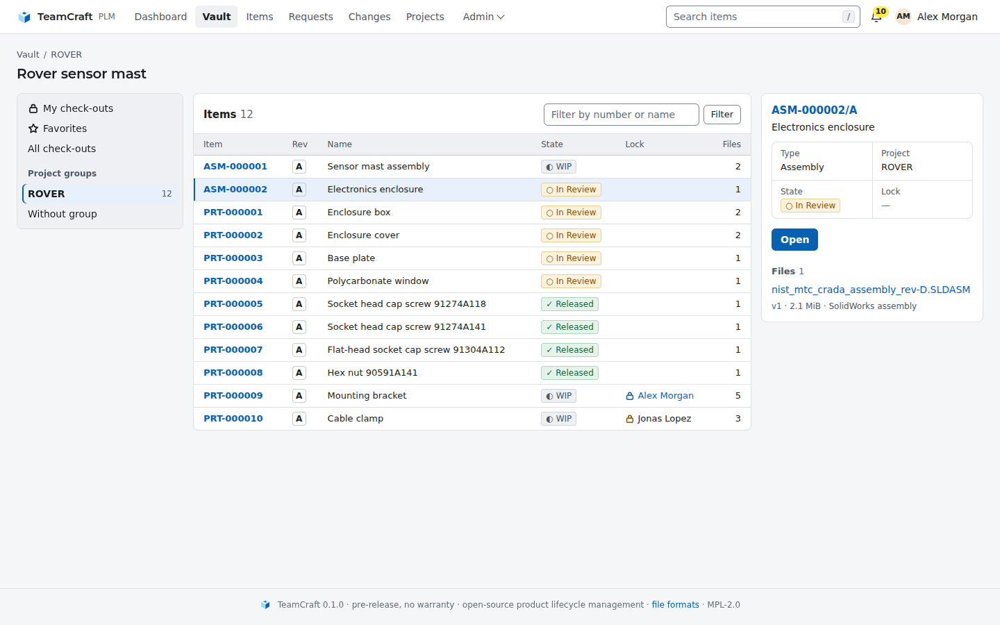</a><br /><sub><b>Vault explorer</b> – project groups, lock owners, one-click check-out</sub></td>
    <td width="50%"><a href="media/screenshots/revision-files.png">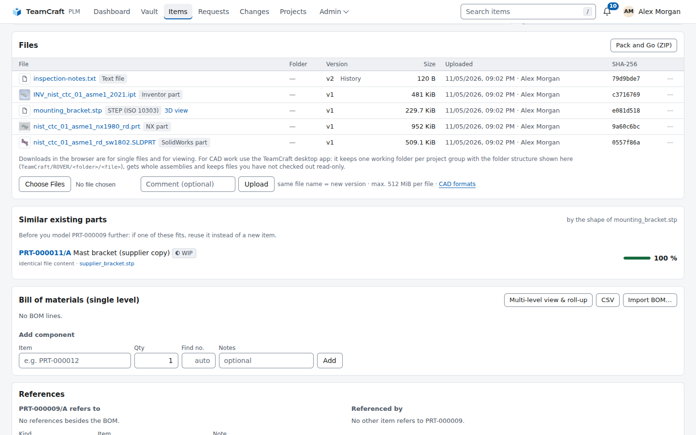</a><br /><sub><b>Revision files</b> – formats, versions and embedded CAD previews</sub></td>
  </tr>
  <tr>
    <td width="50%"><a href="media/screenshots/viewer-3d.png">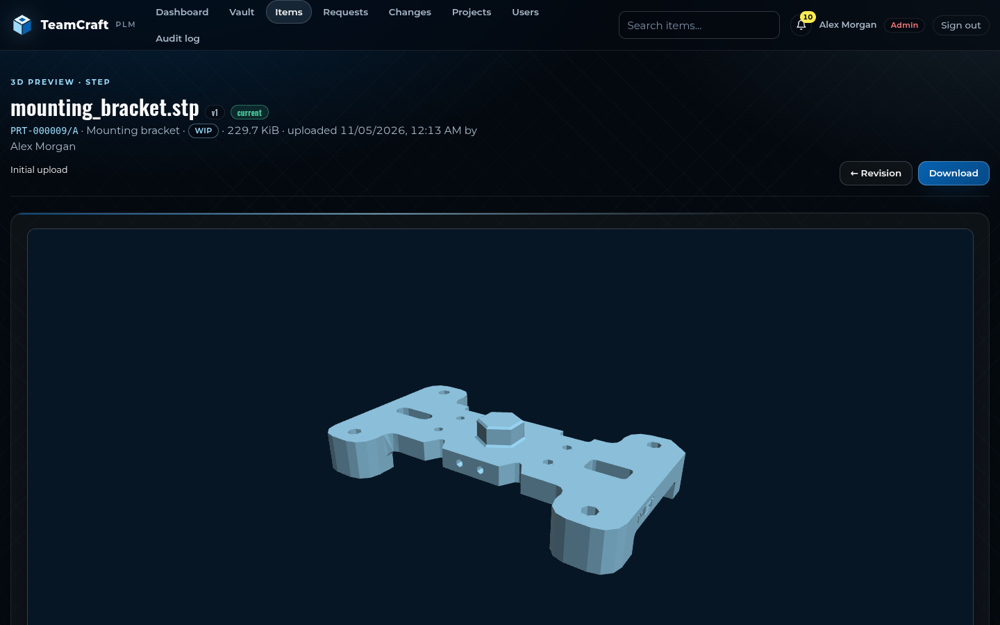</a><br /><sub><b>3D viewer</b> – STEP tessellated on the server, drawn with WebGL</sub></td>
    <td width="50%"><a href="media/screenshots/bom.png">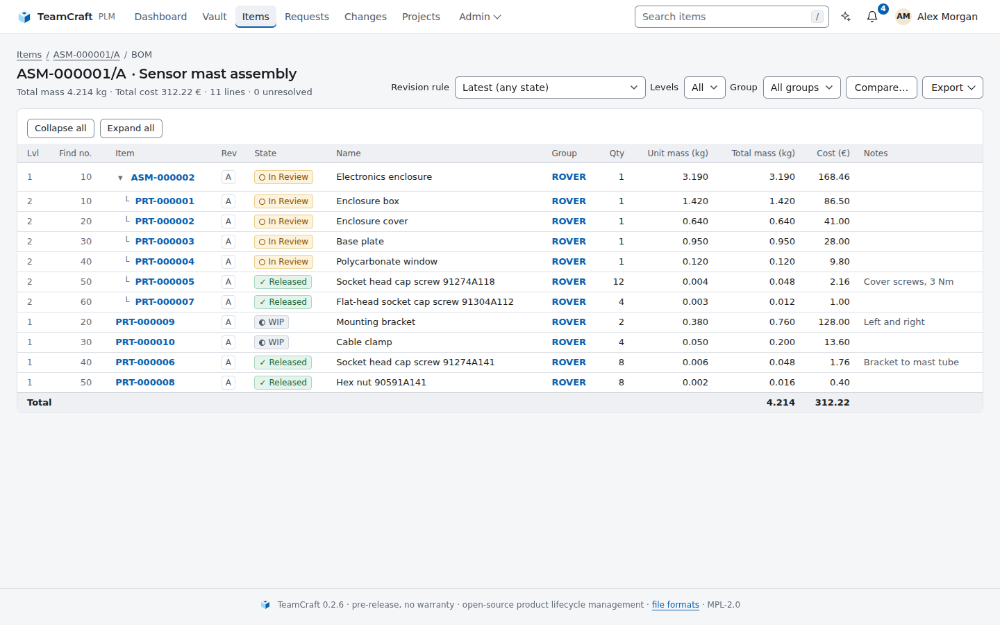</a><br /><sub><b>Multi-level BOM</b> – revision rules, mass and cost roll-up</sub></td>
  </tr>
  <tr>
    <td width="50%"><a href="media/screenshots/change-review.png">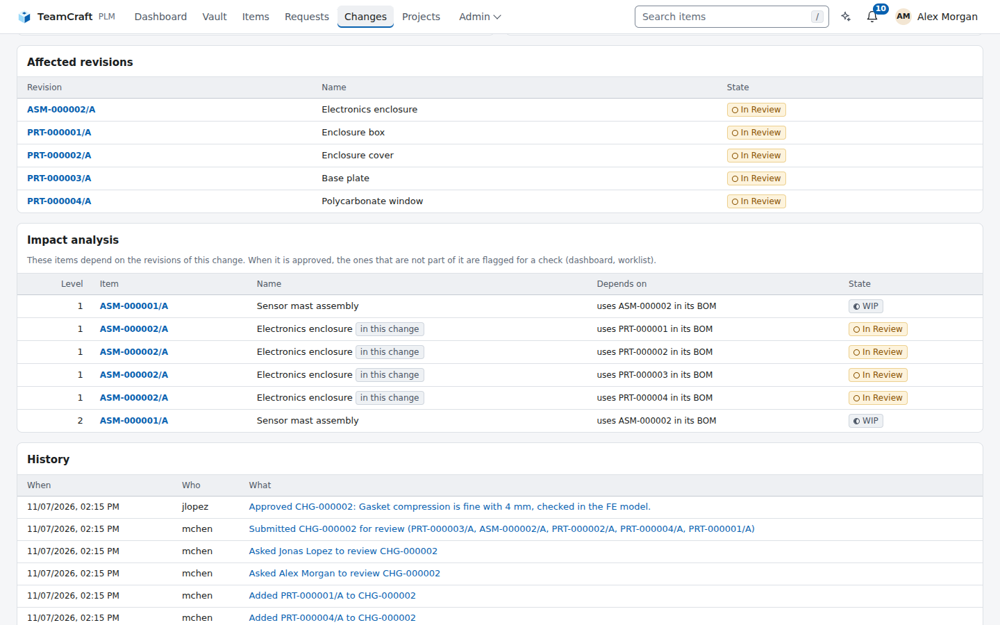</a><br /><sub><b>Change order</b> – four-eyes review and impact analysis</sub></td>
    <td width="50%"><a href="media/screenshots/revision.png">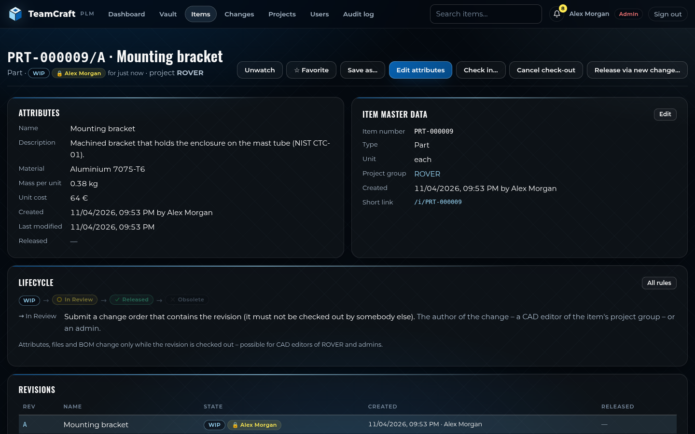</a><br /><sub><b>Revision</b> – attributes, lifecycle and lock</sub></td>
  </tr>
  <tr>
    <td width="50%"><a href="media/screenshots/notifications.png">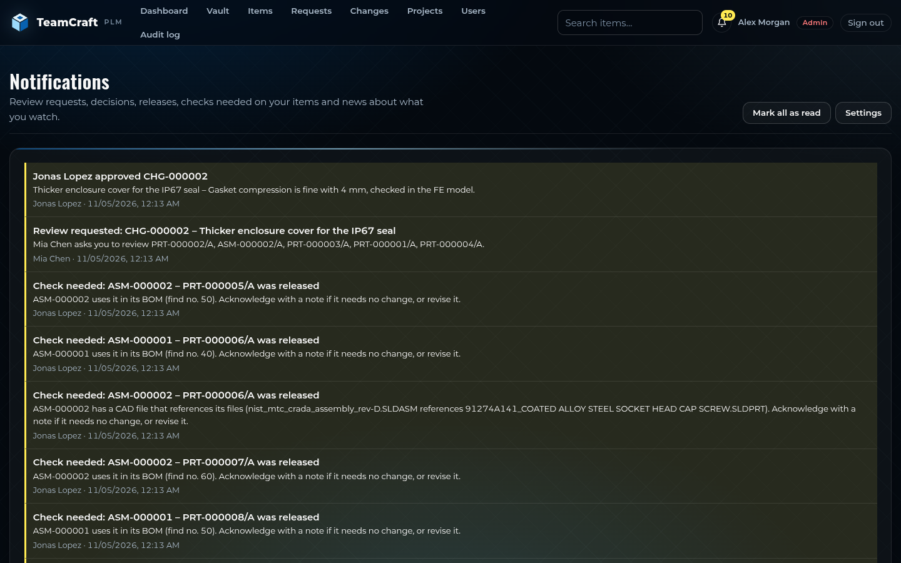</a><br /><sub><b>Notifications</b> – in-app, e-mail and Mattermost</sub></td>
    <td width="50%" align="center"><a href="media/screenshots/mobile-dashboard.png">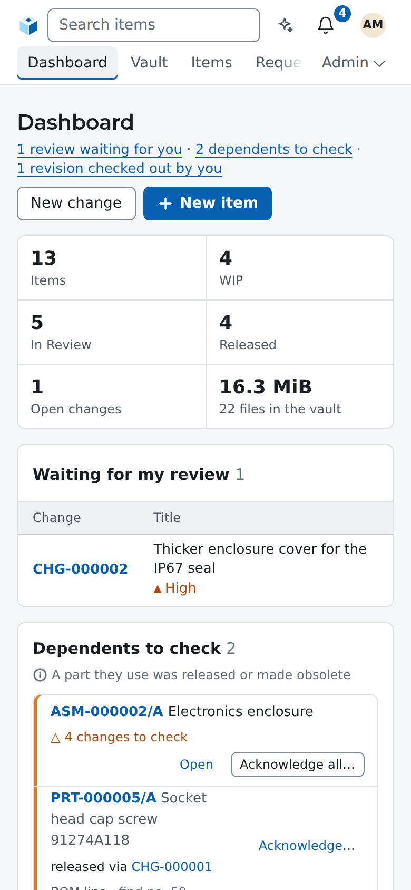</a><br /><sub><b>On the phone</b> – the same pages, responsive</sub></td>
  </tr>
  <tr>
    <td width="50%"><a href="media/screenshots/dashboard-dark.png">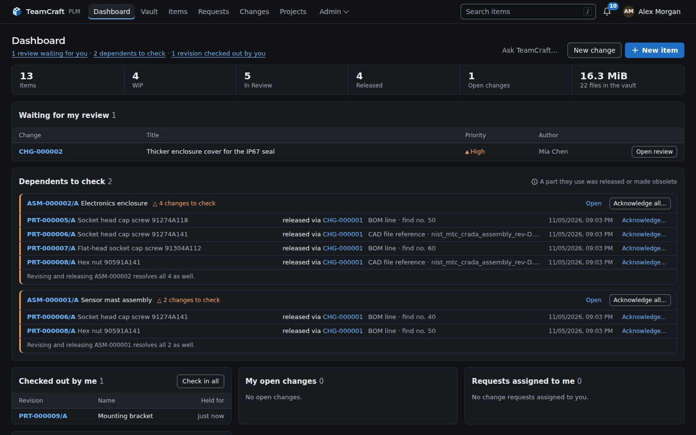</a><br /><sub><b>Dark</b> – follows the system appearance, or pick Light or Dark</sub></td>
    <td width="50%"><a href="media/screenshots/bom-dark.png">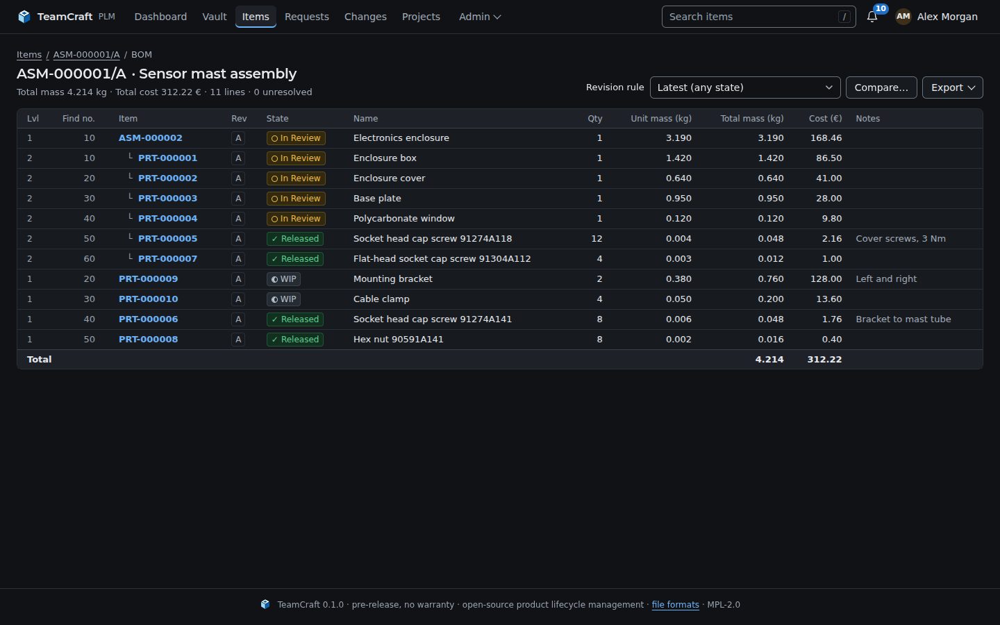</a><br /><sub><b>Multi-level BOM, dark</b> – every page in both schemes</sub></td>
  </tr>
  <tr>
    <td width="50%"><a href="media/screenshots/desktop-home.png">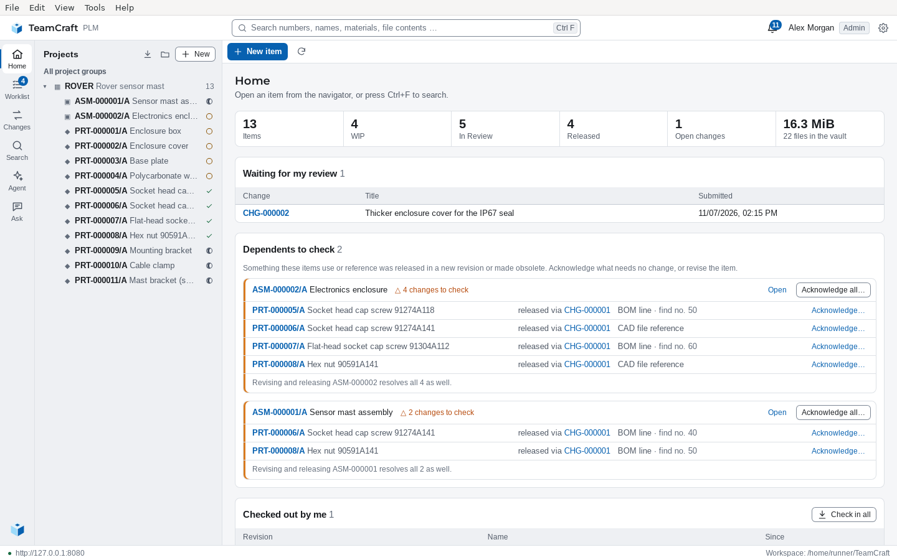</a><br /><sub><b>Desktop app</b> – navigator, statistics and what needs attention</sub></td>
    <td width="50%"><a href="media/screenshots/desktop-revision.png">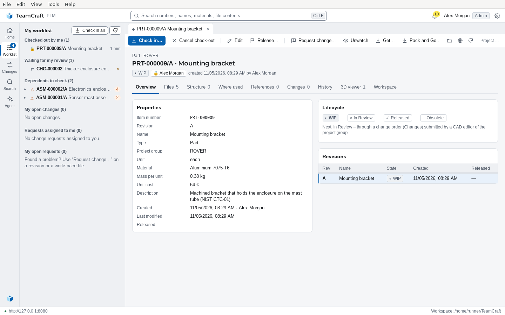</a><br /><sub><b>Desktop revision tab</b> – check-out to a local workspace, check-in</sub></td>
  </tr>
  <tr>
    <td width="50%"><a href="media/screenshots/desktop-change.png">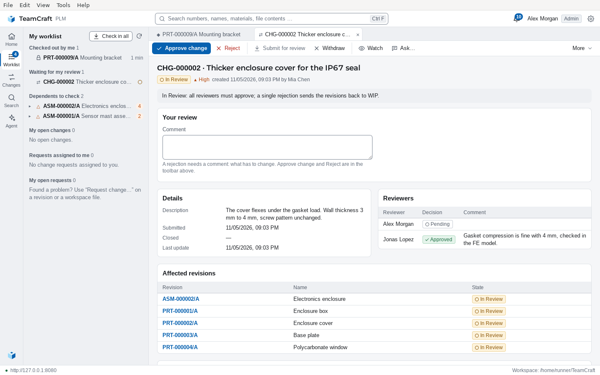</a><br /><sub><b>Desktop review</b> – approve or reject without leaving the app</sub></td>
    <td width="50%"><a href="media/screenshots/desktop-worklist.png">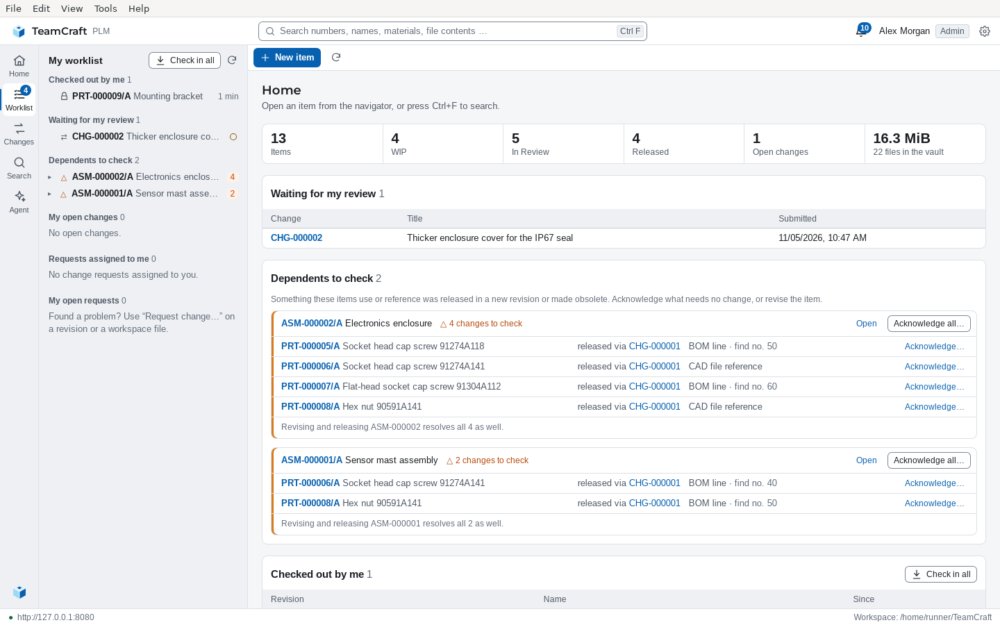</a><br /><sub><b>Desktop worklist</b> – check-outs, reviews and dependents</sub></td>
  </tr>
</table>

## Quick start

**Install on Linux with Docker** – TeamCraft and PostgreSQL in containers,
data in Docker volumes, nothing to build:

```sh
curl -fsSL https://raw.githubusercontent.com/rudalabs/TeamCraft/main/deploy/install.sh | bash
```

The script installs into `/opt/teamcraft` (`--user`: `~/teamcraft`), generates
the database password, starts everything on <http://localhost:8080> and offers
to create the first administrator. Run it again to upgrade; `--dry-run` shows
every step first. Details, backups and TLS:
[Install with Docker](https://rudalabs.github.io/TeamCraft/admin/docker.html).

**From source** (development, macOS, Windows):

```sh
git clone https://github.com/rudalabs/TeamCraft.git && cd TeamCraft
docker compose up -d db     # PostgreSQL on 127.0.0.1, no password needed
cargo run --release         # applies the migrations, serves http://localhost:8080
```

Open <http://localhost:8080> and create the administrator on the login page (offered once, while the server listens on
localhost). Then *Projects → New
project group*, *Items → New item* with a STEP file, and open it in 3D.

No configuration is needed for a local test. Step-by-step guides, including
native PostgreSQL and the desktop app:
**[Linux](platforms/linux.md)** · **[macOS](platforms/macos.md)** · **[Windows](platforms/windows.md)**.

## How it fits together

| Layer                |                                                                                                                    |
|----------------------|--------------------------------------------------------------------------------------------------------------------|
| `teamcraft` binary   | web interface, REST API (`/api/v1`) and CLI in one process; templates, migrations and assets are embedded          |
| `domain`, `services` | the rules and the business logic – permissions, row locks, lifecycle checks and the audit entry in one transaction |
| `vault`              | content-addressed file storage on disk, plus the cached 3D previews                                                |
| `mesh`, `preview`    | pure-Rust readers for meshes, point clouds, STEP and (`simmesh`) VTK/VTU/FRD simulation results                    |
| PostgreSQL 16+       | the only external service                                                                                          |

Everything is built by `cargo` – no Node.js, no downloaded browser engines,
no C++ CAD kernel. Details: [Architecture](https://rudalabs.github.io/TeamCraft/reference/architecture.html).

## Automate it

```sh
API=http://localhost:8080/api/v1; H="Authorization: Bearer $TOKEN"   # token from Account → API tokens
curl -s -X POST -H "$H" $API/items/PRT-000001/revisions/A/checkout
curl -s -X POST -H "$H" -F file=@hub.step -F comment="wall 2 → 2.5 mm" \
     $API/items/PRT-000001/revisions/A/checkin
curl -s -H "$H" "$API/items?q=hub&system=solidworks"
```

## Backup and restore

```sh
teamcraft backup /srv/backups/2026-11-04     # db.dump + vault/objects + manifest.json
teamcraft restore /srv/backups/2026-11-04    # verifies every hash, then restores
```

Both commands need the PostgreSQL client tools (`pg_dump`, `pg_restore`).
The backup directory must not exist or be empty. A restore refuses a
database that already contains tables unless you pass `--force`, and the
server should be stopped while it runs. Configuration and secrets are not
part of a backup; see
[Operations](https://rudalabs.github.io/TeamCraft/admin/operations.html).

## Works with SolidCraft and FieldCraft

TeamCraft recognises [SolidCraft](https://github.com/tangency-labs/solidcraft)
designs (`.sc`, checked by content) and
[FieldCraft](https://github.com/tangency-labs/fieldcraft) models (`.fieldcraft`), and previews their STEP and 3MF
exports – keep design,
export and analysis together in one revision.
[More](https://rudalabs.github.io/TeamCraft/reference/interop.html).

## Documentation

The documentation is published at **<https://rudalabs.github.io/TeamCraft/>**
(built from [`docs/src`](docs/src/SUMMARY.md) with mdBook, plus the
[rustdoc API reference](https://rudalabs.github.io/TeamCraft/api/teamcraft/index.html)):
user guide, administration (configuration, SSO, operations) and reference (file formats, REST API, architecture). A
running server lists its API at
`GET /api/v1` and its formats at `/formats`.

## Contributing

Contributions are welcome: bug reports, tests with real files from your CAD
programs, documentation and code. Please read
**[CONTRIBUTING.md](CONTRIBUTING.md)** first. It covers the development setup,
the checks CI runs, the code conventions and the licence of contributions.
Report security problems privately, as described in [SECURITY.md](SECURITY.md).
Open work and known gaps are listed in [docs/OPEN_WORK.md](docs/OPEN_WORK.md).

## Licence

TeamCraft is licensed under the [Mozilla Public License 2.0](LICENSE)
(`MPL-2.0`). Modified TeamCraft files stay open, and TeamCraft can be
combined with code under other licences in larger works.

**No warranty.** TeamCraft is distributed in the hope that it will be useful,
but it is provided "as is", without warranty of any kind, express or implied.
That includes any warranty that it is free of defects, merchantable, fit for
a particular purpose or non-infringing. The whole risk of using it is yours.
The contributors are not liable for any damages, including data loss. See
sections 6 (*Disclaimer of Warranty*) and 7 (*Limitation of Liability*) of
the [licence](LICENSE).

Third-party components (complete list with versions in `Cargo.lock` and
`desktop/Cargo.lock`):

| Component                            | Used for                                 | Licence                                  |
|--------------------------------------|------------------------------------------|------------------------------------------|
| axum, tower, hyper, tokio            | web server, async runtime                | MIT                                      |
| sqlx                                 | PostgreSQL access, migrations            | MIT / Apache-2.0                         |
| MiniJinja                            | HTML templates                           | Apache-2.0                               |
| truck (truck-stepio, truck-meshalgo) | STEP reading and tessellation            | Apache-2.0                               |
| gltf, quick-xml, zip                 | glTF, 3MF/AMF, Pack and Go               | MIT / Apache-2.0                         |
| csv, calamine, encoding_rs           | BOM import: CSV, Excel/ODS, Windows-1252 | MIT-Unlicense / MIT / MIT-Apache + BSD-3 |
| cfb, crc32fast                       | previews stored in CAD files             | MIT / MIT-Apache                         |
| rust_xlsxwriter                      | Excel export of BOMs and comparisons     | MIT / Apache-2.0                         |
| reqwest, rustls, lettre              | HTTP client, TLS, e-mail                 | MIT / Apache-2.0                         |
| argon2, sha2                         | password hashing, content hashes         | MIT / Apache-2.0                         |
| Tauri 2                              | desktop app                              | MIT / Apache-2.0                         |
| futures-core                         | desktop app: cancellable streamed uploads | MIT / Apache-2.0                        |
| Montserrat, Oswald                   | fonts                                    | SIL OFL 1.1                              |

SolidWorks, NX, Creo, CATIA, Inventor, Fusion,
Revit and the other product names are trademarks of their respective
owners; TeamCraft is not affiliated with them.

[badge-download]: https://img.shields.io/badge/Download-Releases-16a34a?style=for-the-badge&logo=github&logoColor=white
[download]: https://github.com/rudalabs/TeamCraft/releases
[badge-linux]: https://img.shields.io/badge/Linux-Build_from_source-E95420?style=for-the-badge&logo=linux&logoColor=white
[badge-macos]: https://img.shields.io/badge/macOS-Build_from_source-333333?style=for-the-badge&logo=apple&logoColor=white
[badge-windows]: https://img.shields.io/badge/Windows-Build_from_source-0078D6?style=for-the-badge
[badge-docs]: https://img.shields.io/badge/Docs-Read-4b5563?style=for-the-badge&logo=mdbook&logoColor=white
[linux]: platforms/linux.md
[macos]: platforms/macos.md
[windows]: platforms/windows.md
[docs]: https://rudalabs.github.io/TeamCraft/
