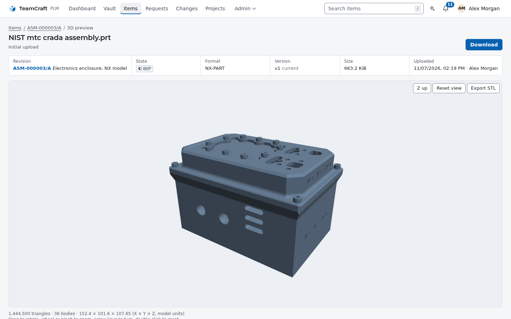
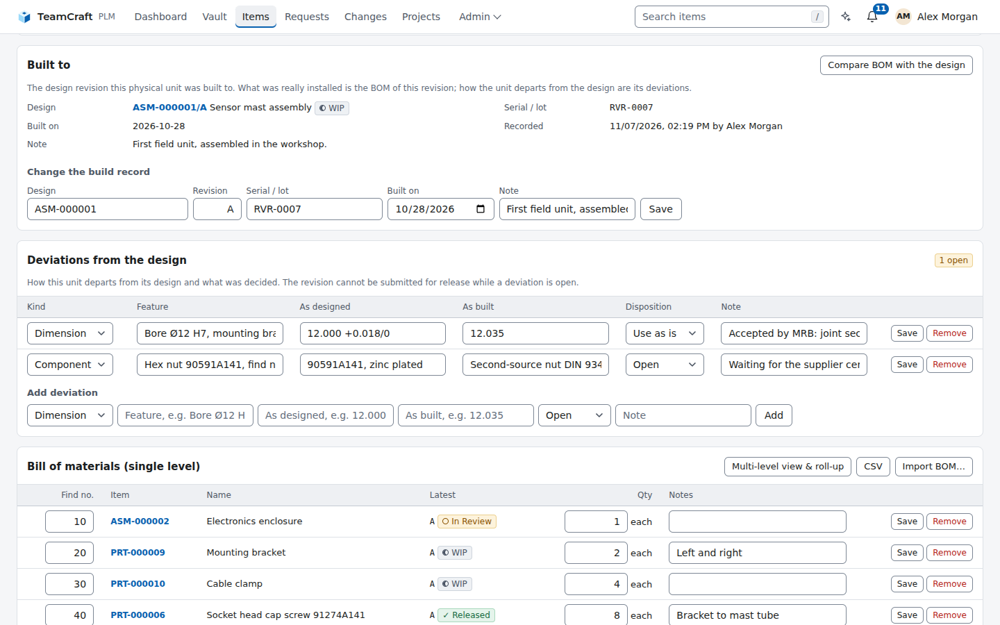
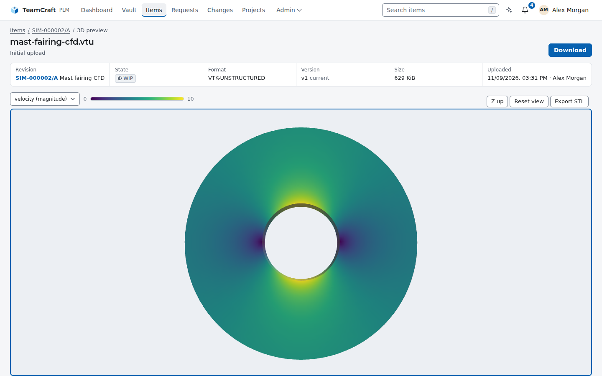
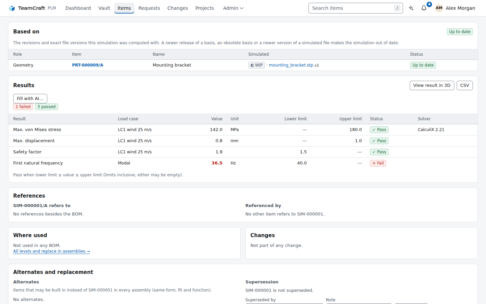
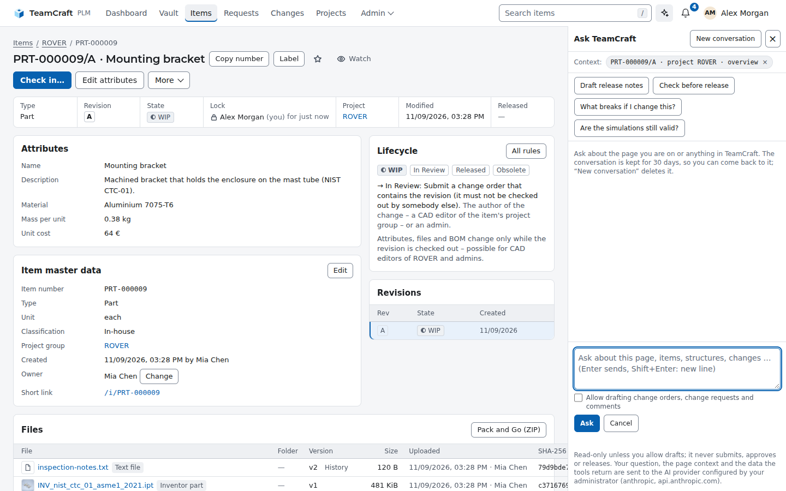
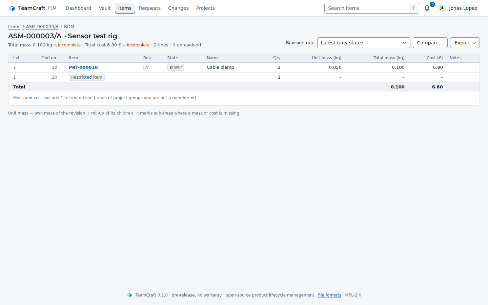
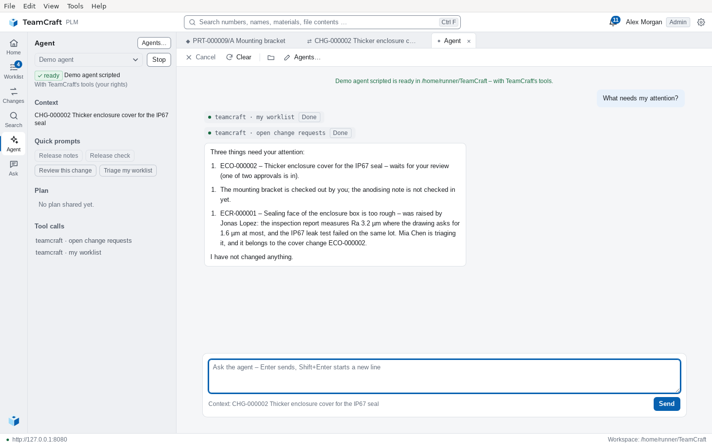

<p align="center">
  
</p>

<h1 align="center">TeamCraft</h1>

<p align="center">
  <strong>Free, open-source product lifecycle management, built in pure Rust.</strong><br />
  For early-stage startups and large student teams that have outgrown shared folders.<br />
  Check your CAD data out and in, keep every version, release with reviews,
  follow changes through assemblies and see STEP, NX, mesh and point-cloud models
  in 3D – in the browser, in the desktop app or through the REST API.<br />
  <em>Work in progress: an open-source alternative to Siemens Teamcenter.</em>
</p>

<div align="center">

[![Download][badge-download]][download]
[![Linux][badge-linux]][linux]
[![macOS][badge-macos]][macos]
[![Windows][badge-windows]][windows]
[![Documentation][badge-docs]][docs]

</div>

<p align="center">
  <a href="https://github.com/rudalabs/TeamCraft/actions/workflows/ci.yml"></a>
  <a href="https://github.com/rudalabs/TeamCraft/actions/workflows/desktop.yml"></a>
  <a href="https://github.com/rudalabs/TeamCraft/actions/workflows/docs.yml"></a>
  <a href="https://www.repostatus.org/#wip"></a>
  <a href="https://github.com/rudalabs/TeamCraft/releases"></a>
  <a href="LICENSE"></a>
  
  
</p>

<p align="center">
  <a href="https://rudalabs.github.io/TeamCraft/">Documentation</a> ·
  <a href="#download">Download</a> ·
  <a href="#quick-start">Quick start</a> ·
  <a href="#features">Features</a> ·
  <a href="#enterprise-management">Enterprise management</a> ·
  <a href="https://rudalabs.github.io/TeamCraft/guide/tour.html">Feature tour</a> ·
  <a href="https://rudalabs.github.io/TeamCraft/reference/formats.html">File formats</a> ·
  <a href="https://rudalabs.github.io/TeamCraft/reference/api.html">REST API</a> ·
  <a href="https://rudalabs.github.io/TeamCraft/api/teamcraft/index.html">Rust API</a> ·
  <a href="CONTRIBUTING.md">Contributing</a>
</p>

<p align="center">
  
</p>

> [!WARNING]
> **Work in progress: there is no official release yet.** TeamCraft is under
> active development (version 0.x). Features, the REST API, the configuration
> and the database schema can still change at any time. You are welcome to
> try it out and test it, and please
> [report what you find](https://github.com/rudalabs/TeamCraft/issues).
> Don't use it for production data yet, and keep backups of the database and
> the vault.
>
> TeamCraft is provided **"as is", without warranty of any kind**. There is no
> guarantee that it works as described or is fit for any particular purpose,
> and no liability for any damage or data loss. See sections 6 and 7 of the
> [MPL-2.0](LICENSE).

## Who it is for

TeamCraft is free of charge and open source (MPL-2.0): no licence fees, no
seat counts, no vendor lock-in, and the data stays in your own PostgreSQL
database and file vault. It is made for teams that need to professionalise
their PLM / PDM before they can afford, or justify, a commercial system:

- **Early-stage hardware startups** – the first customer, auditor or investor
  asks which revision was delivered, who approved it and what changed since.
  TeamCraft gives you released revisions, change orders with reviews, BOMs and
  an audit trail from day one, on one server you run yourself.
- **Large student organisations** – racing, rocketry, satellite, robotics and
  similar teams with dozens to hundreds of members, a new generation every
  year and real engineering hand-overs. Knowledge stays in the system instead
  of in the inbox of last year's lead: what was built, from which revision,
  with which simulation results and which deviations.

In both cases, "professionalise" means the same things: check-out instead of
overwriting each other's files, revisions and releases instead of
`final_v3_really_final.step`, reviewed change orders, traceable BOMs, and
onboarding where new members sign in with the accounts they already have.

## Quick start

**Install on Linux with Docker** – TeamCraft and PostgreSQL in containers,
data in Docker volumes, nothing to build:

```sh
curl -fsSL https://raw.githubusercontent.com/rudalabs/TeamCraft/main/deploy/install.sh | bash
```

The script installs into `/opt/teamcraft` (`--user`: `~/teamcraft`), generates
the database password, starts everything on <http://localhost:8080> and offers
to create the first administrator. Run it again to upgrade; `--dry-run` shows
every step first. Details, backups and TLS:
[Install with Docker](https://rudalabs.github.io/TeamCraft/admin/docker.html).

**From source** (development, macOS, Windows):

```sh
git clone https://github.com/rudalabs/TeamCraft.git && cd TeamCraft
docker compose up -d db     # PostgreSQL on 127.0.0.1, no password needed
cargo run --release         # applies the migrations, serves http://localhost:8080
```

Open <http://localhost:8080> and create the administrator on the login page
(offered once, while the server listens on localhost). Then *Projects → New
project group*, *Items → New item* with a STEP file, and open it in 3D.

No configuration is needed for a local test. Step-by-step guides, including
native PostgreSQL and the desktop app:
**[Linux](platforms/linux.md)** · **[macOS](platforms/macos.md)** · **[Windows](platforms/windows.md)**.

## Download

Builds of every tagged version are on the
**[Releases page](https://github.com/rudalabs/TeamCraft/releases)** – 0.x
versions are pre-releases (see the warning above):

|                          | Linux x86_64                            | Linux ARM64                | macOS (Apple silicon) | Windows x64                                   | Windows ARM64                                     |
|--------------------------|-----------------------------------------|----------------------------|-----------------------|-----------------------------------------------|---------------------------------------------------|
| **Server** (`teamcraft`) | `.tar.gz`                               | `.tar.gz`                  | –                     | `.zip`                                        | –                                                 |
| **Desktop app**          | `.AppImage`, `.deb`, `.rpm`, `.flatpak` | `.deb`, `.rpm`, `.flatpak` | `.dmg`, `.app.zip`    | `.msi`, `_x64-setup.exe`, `_x64_portable.zip` | `.msi`, `_arm64-setup.exe`, `_arm64_portable.zip` |

- **Server:** runs on Linux in production, or as the
  [Docker image](docs/src/admin/docker.md) on any platform. On macOS, build it
  from source ([platforms/macos.md](platforms/macos.md)).
- **Flatpak:** `flatpak install --user TeamCraft_*.flatpak`; the GNOME runtime
  comes from Flathub. Packages for Arch (AUR) and snap:
  [packaging/](packaging/README.md).
- **Windows portable:** the `_portable.zip` holds `TeamCraft.exe` without an
  installer; it needs the WebView2 runtime, which Windows 10 and 11 include.
- **Checksums:** `sha256sum -c --ignore-missing SHA256SUMS.txt`.
- **Not code-signed yet:** macOS asks to confirm the first start
  (*right-click → Open*); Windows SmartScreen shows *More info → Run anyway*.
- **Newest `main` build:** built every night; attached as artifacts to the latest run of the
  [Release workflow](https://github.com/rudalabs/TeamCraft/actions/workflows/release.yml)
  (kept 14 days, for signed-in GitHub users).

## Features

Everything below works end to end today and is covered by unit tests and
end-to-end tests against a real PostgreSQL.

**Files and versions**

- **Check-out / check-in** – exclusive locks per revision; a check-in based on
  an outdated version is refused instead of overwriting it.
- **Versions and rollback** – every upload is a new version; download or
  restore any of them, history is never rewritten.
- **Vault explorer** – project groups as folders with lock owners, files and
  one-click check-out / check-in.
- **Large uploads** – chunked, resumable uploads in the web UI; identical files
  are stored once (SHA-256).
- **160+ file formats** – native CAD, BIM and DCC files plus STEP, IGES, JT,
  IFC, glTF, USD, E57, LAS and more are recognised.

**Previews and search**

- **3D preview** – in the browser, converted on the server, no plug-ins:
  STEP, NX, SOLIDWORKS and Inventor parts and assemblies (put together from
  their part files, hidden components left out), CATIA V5 parts, Creo parts
  (tessellated from their exact B-rep), Rhino models (`.3dm`, SubD included),
  SketchUp models (`.skp`, SketchUp 3 to today), JT files with their whole
  assembly, Fusion designs (`.f3d`), STL, OBJ, PLY, 3MF, glTF, point clouds
  and more.
- **CAD thumbnails** – the preview images stored in Inventor drawings and Solid
  Edge files; NX, SOLIDWORKS, Inventor, CATIA, Creo, Rhino, SketchUp, JT and
  Fusion files get a sharper thumbnail rendered from their 3D preview.
- **FEA/CFD results** – VTK, VTU/VTP and CalculiX results coloured by a result
  field, with legend.
- **Search** – ranked full-text search over numbers, names, materials, file
  names and file contents.
- **Similar parts** – on every revision with a STEP or mesh file, existing
  parts of similar 3D shape and size, with the reason for each hit.

**Structure**

- **Multi-level BOM** – mass and cost roll-up, revision rules, comparison of
  two revisions, CSV/Excel export.
- **Mass properties** – mass, centre of gravity and inertia tensor of a whole
  assembly or vehicle from the exported meshes of its parts, a material
  library of densities and measured masses of bought parts; CSV/JSON export.
- **Where-used** – every assembly a part is used in, over all levels.
- **Alternates and supersession** – alternate parts, superseded parts and
  *Replace in assemblies* with a preview.
- **BOM import** – items and BOMs from CAD BOM tables (CSV, Excel, ODS) or a
  STEP assembly; preview first, one transaction.
- **Pack and Go** – a ZIP of a whole assembly with all its files.

**Change and release**

- **Lifecycle** – WIP → In Review → Released → Obsolete with revision letters
  after ASME Y14.35; released data never changes.
- **Change requests (ECR)** – anybody reports a problem with screenshots;
  editors accept, defer or reject.
- **Change orders** – reviewers, four-eyes approval, impact analysis and an
  atomic release of all revisions.
- **Change propagation** – references inside CAD files are tracked; a release
  flags every dependent for a check.
- **Release readiness** – a check of a BOM for missing, unreleased or outdated
  parts before release.

**Simulation and manufacturing**

- **Simulation management** – FEA/CFD items linked to the exact revisions they
  analysed, flagged *out of date* when the design changes.
- **Result values** – key values with limits and pass/fail, CSV/Excel import
  and comparison between revisions.
- **As-built records** – one item per physical unit: the design revision it
  was built to, serial number, as-built BOM and deviations with a disposition
  (use as is, rework, repair, scrap).

**Teams and administration**

- **Roles and read permissions** – viewer, editor and admin roles; restricted
  project groups visible only to their members.
- **Single sign-on** – any OpenID Connect provider, with group
  synchronisation and back-channel logout.
- **Offboarding** – for teams that change every season: everything a leaver
  still holds in one report, *Offboard and deactivate* in one step (hand-over
  of work and manager roles, token revocation, release of check-outs),
  *Season handover* of a whole project group, groups left without an active
  manager, and SSO users who stopped signing in.
- **Numbering schemes** – generated item numbers per project group from
  `{PROJECT}`, `{TYPE}`, `{YYYY}` and `{SEQ:n}`.
- **Custom attributes** – vendor, supplier part number, RoHS … as text,
  number, yes/no or choice list per item type, versioned with each revision;
  search by attribute value.
- **Notifications** – in-app, e-mail and Mattermost; watch items, changes and
  change requests.
- **Event webhooks** – signed JSON for releases, changes and simulation
  results, retried with backoff.
- **Audit log** – every modification and every sign-in (password, SSO, failed
  attempts) with user, time and details; repeated failed sign-ins are slowed
  down.
- **Branding** – your own wide and square logo and header name under
  *Admin → Branding*, also in the desktop app; footer, About and licence
  notices stay TeamCraft.
- **Monitoring** – `/healthz`, `/readyz` and Prometheus metrics at `/metrics`
  (requests, database pool, outbox backlogs, preview queue), enabled with a
  token.
- **Backup and restore** – one command for database and vault
  ([below](#command-line-and-api)).

**Clients and integrations**

- **Web UI** – light and dark design that follows the operating system, plus
  distribution skins; responsive down to phone width.
- **Desktop app** – Linux, macOS and Windows client with a local working
  folder, *Get* of whole assemblies, an import wizard, a *Files* view of each
  project group, a navigable *Graph* of every revision (BOM children,
  references and where-used, coloured by state, with quantities and preview
  images), *Park* of work in progress, an Agent view, crash reports the user
  decides about and an update notice (never installs anything itself).
- **REST API** – everything the UI does, with personal access tokens.
- **MCP server** – AI assistants such as Claude Code search, explain BOMs and
  draft changes with your rights, never approving anything.
- **Ask TeamCraft (optional)** – an AI sidebar on every page that knows which
  page you are on and works with your rights, read-only by default. It runs on
  your own key for Anthropic, OpenAI, Azure OpenAI or any OpenAI-compatible
  service, or a local model (Ollama, vLLM). In the desktop app it is the
  *Agent* view's company AI.
- **SolidCraft and FieldCraft** – [SolidCraft](https://github.com/tangency-labs/solidcraft)
  designs (`.sc`, checked by content) and
  [FieldCraft](https://github.com/tangency-labs/fieldcraft) models
  (`.fieldcraft`) are recognised and their STEP and 3MF exports previewed –
  design, export and analysis in one revision
  ([more](https://rudalabs.github.io/TeamCraft/reference/interop.html)).

## Enterprise management

The features an IT department or a team lead asks about before rolling a
system out to an organisation. All of them are part of the free release –
there is no separate enterprise edition.

- **Identity and access**
  - Single sign-on with any OpenID Connect provider (Keycloak, Entra ID,
    Google, Authentik …); IdP groups mapped to roles and project groups.
  - Viewer / editor / admin roles, and
    [restricted project groups](https://rudalabs.github.io/TeamCraft/admin/permissions.html)
    that stay invisible to outsiders – even inside BOMs, search,
    notifications and the AI assistant.
  - Per group, administrators can be limited to audited, time-limited access
    with a written reason, or to managing without reading.
  - [Need-to-know groups](https://rudalabs.github.io/TeamCraft/admin/permissions.html):
    membership conditions (IdP claims, networks, maximum sign-in age), a
    read and download log, and periodic access reviews with an evidence
    report.
  - Personal access tokens can be scoped: full, write without approving,
    read-only or MCP-only; SSO users' tokens can expire after a number of
    idle days.
  - [Offboarding](https://rudalabs.github.io/TeamCraft/admin/users.html#when-someone-leaves)
    for high-turnover teams: a holdings report per user, *Offboard and
    deactivate*, season handover per group, groups without an active
    manager, OpenID Connect back-channel logout and a report of SSO users
    who stopped signing in.
- **Traceability**
  - An [audit log](https://rudalabs.github.io/TeamCraft/admin/operations.html)
    of every change and every sign-in, failed attempts included, exportable
    as CSV or JSON.
  - Four-eyes change orders: nobody who wrote, prepared or changed the data
    can approve it. Review policies per project group, review rounds,
    optional sign-off with the password or a fresh SSO sign-in, and the
    approvers named in every Pack and Go manifest.
  - Released data never changes; as-built records per serial number.
- **Company AI instead of shadow AI**
  - *Ask TeamCraft* runs on the AI service the organisation chooses; the key
    stays on the server and never reaches a browser or the desktop app.
  - The assistant works with each user's rights, read-only by default, and
    every question is audited (without its content).
  - `TEAMCRAFT_LOCAL_AGENTS=off` switches off local AI agents: the desktop
    app's Agent then runs on the company AI only. *Admin → AI* shows the
    setup.
- **Operations**
  - [Docker install](https://rudalabs.github.io/TeamCraft/admin/docker.html)
    with one script.
  - [Backup and restore](https://rudalabs.github.io/TeamCraft/admin/operations.html#backups)
    of database and vault in one command.
  - `/healthz` and `/readyz` probes and
    [Prometheus metrics](https://rudalabs.github.io/TeamCraft/admin/operations.html#metrics-for-prometheus).
  - Documented [upgrades](https://rudalabs.github.io/TeamCraft/admin/upgrade.html)
    and a [support policy](https://rudalabs.github.io/TeamCraft/admin/support-policy.html).
- **Integration** – REST API, an MCP server for AI tools, signed
  [event webhooks](https://rudalabs.github.io/TeamCraft/admin/webhooks.html),
  e-mail and Mattermost notifications.
- **Your look** – your own logos and header name under *Admin → Branding*, in
  the web UI and the desktop app.
- **Configuration** – everything through environment variables, each also as
  `*_FILE` for Docker or Kubernetes secrets; see the
  [configuration reference](https://rudalabs.github.io/TeamCraft/admin/configuration.html).

**Planned** – what is left of the issues above (all their steps are built):

- **Need-to-know projects** ([#151](https://github.com/rudalabs/TeamCraft/issues/151))
  – optional: a watermark on downloads, claims for local accounts.
- **Ownership and approval rules** ([#152](https://github.com/rudalabs/TeamCraft/issues/152))
  – substitutes per user, the review policy shown on the change page.
- **Offboarding for high-turnover teams** ([#173](https://github.com/rudalabs/TeamCraft/issues/173))
  – a timed stale-lock rule, the access review page for groups that are not
  need-to-know; automatic deprovisioning through SCIM is not planned for now
  ([research](https://rudalabs.github.io/TeamCraft/research/scim-deprovisioning.html)).

TeamCraft is a community project without commercial support or a service
level agreement.

## Screenshots

Demo data from the openly licensed [NIST CAD test files](tests/fixtures/cad/README.md),
captured automatically by [`scripts/screenshots.sh`](scripts/screenshots.sh) –
the web UI with headless Chrome, TeamCraft Desktop on a virtual X display.

<table>
  <tr>
    <td width="50%"><a href="media/screenshots/vault-explorer.png"></a><br /><sub><b>Vault explorer</b> – project groups, lock owners, one-click check-out</sub></td>
    <td width="50%"><a href="media/screenshots/revision-files.png"></a><br /><sub><b>Revision files</b> – formats, versions, CAD previews and similar existing parts</sub></td>
  </tr>
  <tr>
    <td width="50%"><a href="media/screenshots/nx-assembly-3d.png"></a><br /><sub><b>NX in 3D</b> – parts from their JT data, assemblies put together from their parts</sub></td>
    <td width="50%"><a href="media/screenshots/bom.png"></a><br /><sub><b>Multi-level BOM</b> – revision rules, mass and cost roll-up</sub></td>
  </tr>
  <tr>
    <td width="50%"><a href="media/screenshots/change-review.png"></a><br /><sub><b>Change order</b> – affected revisions and impact analysis</sub></td>
    <td width="50%"><a href="media/screenshots/as-built.png"></a><br /><sub><b>As-built records</b> – serial number, as-built BOM and deviations</sub></td>
  </tr>
  <tr>
    <td width="50%"><a href="media/screenshots/simulation-cfd-3d.png"></a><br /><sub><b>FEA/CFD results in 3D</b> – VTK and CalculiX results coloured by field</sub></td>
    <td width="50%"><a href="media/screenshots/simulation-results.png"></a><br /><sub><b>Simulation results</b> – linked to the analysed revision, with limits and pass/fail</sub></td>
  </tr>
  <tr>
    <td width="50%"><a href="media/screenshots/assistant-sidebar.png"></a><br /><sub><b>Ask TeamCraft</b> – knows the page you are on, works with your rights</sub></td>
    <td width="50%"><a href="media/screenshots/restricted-bom.png"></a><br /><sub><b>Read permissions</b> – restricted groups stay hidden, even inside BOMs</sub></td>
  </tr>
  <tr>
    <td width="50%"><a href="media/screenshots/desktop-home.png"></a><br /><sub><b>Desktop app</b> – navigator, statistics and what needs attention</sub></td>
    <td width="50%"><a href="media/screenshots/desktop-revision.png"></a><br /><sub><b>Desktop revision tab</b> – check-out to a local workspace, check-in</sub></td>
  </tr>
  <tr>
    <td width="50%"><a href="media/screenshots/desktop-change.png"></a><br /><sub><b>Desktop review</b> – four-eyes approval without leaving the app</sub></td>
    <td width="50%"><a href="media/screenshots/desktop-agent.png"></a><br /><sub><b>Desktop agent</b> – a local AI agent next to your PDM data</sub></td>
  </tr>
  <tr>
    <td width="50%"><a href="media/screenshots/bom-dark.png"></a><br /><sub><b>Dark</b> – follows the system appearance, or pick Light or Dark</sub></td>
    <td width="50%" align="center"><a href="media/screenshots/mobile-dashboard.png"></a><br /><sub><b>On the phone</b> – the same pages, responsive</sub></td>
  </tr>
</table>

## How it fits together

| Layer                |                                                                                                                    |
|----------------------|--------------------------------------------------------------------------------------------------------------------|
| `teamcraft` binary   | web interface, REST API (`/api/v1`) and CLI in one process; templates, migrations and assets are embedded          |
| `domain`, `services` | the rules and the business logic – permissions, row locks, lifecycle checks and the audit entry in one transaction |
| `vault`              | content-addressed file storage on disk, plus the cached 3D previews                                                |
| `mesh`, `preview`    | pure-Rust readers for meshes, point clouds, STEP and (`simmesh`) VTK/VTU/FRD simulation results                    |
| PostgreSQL 16+       | the only external service                                                                                          |

Everything is built by `cargo` – no Node.js, no downloaded browser engines,
no C++ CAD kernel. Details:
[Architecture](https://rudalabs.github.io/TeamCraft/reference/architecture.html).

## Command line and API

The REST API, with a token from *Account → API tokens*:

```sh
API=http://localhost:8080/api/v1; H="Authorization: Bearer $TOKEN"
curl -s -X POST -H "$H" $API/items/PRT-000001/revisions/A/checkout
curl -s -X POST -H "$H" -F file=@hub.step -F comment="wall 2 → 2.5 mm" \
     $API/items/PRT-000001/revisions/A/checkin
curl -s -H "$H" "$API/items?q=hub&system=solidworks"
```

Backup and restore of database and vault:

```sh
teamcraft backup /srv/backups/2026-11-04     # db.dump + vault/objects + manifest.json
teamcraft restore /srv/backups/2026-11-04    # verifies every hash, then restores
```

Both commands need the PostgreSQL client tools (`pg_dump`, `pg_restore`). The
backup directory must not exist or must be empty. A restore refuses a database
that already contains tables unless you pass `--force`, and the server should
be stopped while it runs. Configuration and secrets are not part of a backup;
see [Operations](https://rudalabs.github.io/TeamCraft/admin/operations.html).

## Documentation

Published at **<https://rudalabs.github.io/TeamCraft/>**, built from
[`docs/src`](docs/src/SUMMARY.md) with mdBook, plus the
[rustdoc API reference](https://rudalabs.github.io/TeamCraft/api/teamcraft/index.html):

- **User guide** – a [feature tour](https://rudalabs.github.io/TeamCraft/guide/tour.html)
  and every workflow.
- **Administration** – configuration, SSO, permissions, operations.
- **Reference** – [file formats](https://rudalabs.github.io/TeamCraft/reference/formats.html),
  [REST API](https://rudalabs.github.io/TeamCraft/reference/api.html),
  architecture.

A running server lists its API at `GET /api/v1` and its formats at `/formats`.

## Contributing

Contributions are welcome: bug reports, tests with real files from your CAD
programs, documentation and code. Please read
**[CONTRIBUTING.md](CONTRIBUTING.md)** first – it covers the development
setup, the checks CI runs, the code conventions and the licence of
contributions. Report security problems privately, as described in
[SECURITY.md](SECURITY.md). Open work and known gaps are listed in
[docs/OPEN_WORK.md](docs/OPEN_WORK.md).

## Licence

TeamCraft is licensed under the [Mozilla Public License 2.0](LICENSE)
(`MPL-2.0`). Modified TeamCraft files stay open, and TeamCraft can be
combined with code under other licences in larger works.

**No warranty.** TeamCraft is distributed in the hope that it will be useful,
but it is provided "as is", without warranty of any kind, express or implied.
That includes any warranty that it is free of defects, merchantable, fit for
a particular purpose or non-infringing. The whole risk of using it is yours.
The contributors are not liable for any damages, including data loss. See
sections 6 (*Disclaimer of Warranty*) and 7 (*Limitation of Liability*) of
the [licence](LICENSE).

Third-party components (complete list with versions in `Cargo.lock` and
`desktop/Cargo.lock`):

| Component                            | Used for                                    | Licence                                                      |
|--------------------------------------|---------------------------------------------|--------------------------------------------------------------|
| axum, tower, hyper, tokio            | web server, async runtime                   | MIT                                                          |
| sqlx                                 | PostgreSQL access, migrations               | MIT / Apache-2.0                                             |
| MiniJinja                            | HTML templates                              | Apache-2.0                                                   |
| truck (truck-stepio, truck-meshalgo) | STEP reading and tessellation               | Apache-2.0                                                   |
| gltf, quick-xml, zip                 | glTF, 3MF/AMF, Pack and Go                  | MIT / Apache-2.0                                             |
| csv, calamine, encoding_rs           | BOM import: CSV, Excel/ODS, Windows-1252    | MIT-Unlicense / MIT / MIT-Apache + BSD-3                     |
| cfb, crc32fast                       | previews stored in CAD files                | MIT / MIT-Apache                                             |
| lzma-rs, ruzstd                      | JT 10 scene graphs, Zstandard segments of Inventor files | MIT                                     |
| pdf_oxide                            | text of PDF reports for the search          | MIT / Apache-2.0                                             |
| OpenSKP (Rust port, vendored in `vendor/openskp`, © 2024–2026 Ahsan Mehmood) | SketchUp 3–2020 files in the 3D preview | MIT          |
| earcut algorithm (© 2016 Mapbox, ported in `src/mesh/earcut.rs`) | triangulating SketchUp faces    | ISC                                                          |
| rust_xlsxwriter                      | Excel export of BOMs and comparisons        | MIT / Apache-2.0                                             |
| qrcode                               | QR codes on item labels (SVG)               | MIT / Apache-2.0                                             |
| chacha20poly1305 (RustCrypto)        | encrypted backups                           | MIT / Apache-2.0                                             |
| reqwest, rustls, lettre              | HTTP client, TLS, e-mail                    | MIT / Apache-2.0                                             |
| argon2, sha2                         | password hashing, content hashes            | MIT / Apache-2.0                                             |
| ring                                 | signatures of OIDC back-channel logout tokens | Apache-2.0 AND ISC                                         |
| Tauri 2                              | desktop app                                 | MIT / Apache-2.0                                             |
| futures-core                         | desktop app: cancellable streamed uploads   | MIT / Apache-2.0                                             |
| Montserrat, Oswald                   | fonts                                       | SIL OFL 1.1                                                  |
| libfuzzer-sys (libFuzzer)            | fuzz targets in `fuzz/` only, never shipped | MIT / Apache-2.0 (libFuzzer: Apache-2.0 with LLVM exception) |

SolidWorks, NX, Creo, CATIA, Inventor, Fusion,
Revit and the other product names are trademarks of their respective
owners; TeamCraft is not affiliated with them.

[badge-download]: https://img.shields.io/badge/Download-Releases-16a34a?style=for-the-badge&logo=github&logoColor=white
[download]: https://github.com/rudalabs/TeamCraft/releases
[badge-linux]: https://img.shields.io/badge/Linux-Guide-E95420?style=for-the-badge&logo=linux&logoColor=white
[badge-macos]: https://img.shields.io/badge/macOS-Guide-333333?style=for-the-badge&logo=apple&logoColor=white
[badge-windows]: https://img.shields.io/badge/Windows-Guide-0078D6?style=for-the-badge
[badge-docs]: https://img.shields.io/badge/Docs-Read-4b5563?style=for-the-badge&logo=mdbook&logoColor=white
[linux]: platforms/linux.md
[macos]: platforms/macos.md
[windows]: platforms/windows.md
[docs]: https://rudalabs.github.io/TeamCraft/
